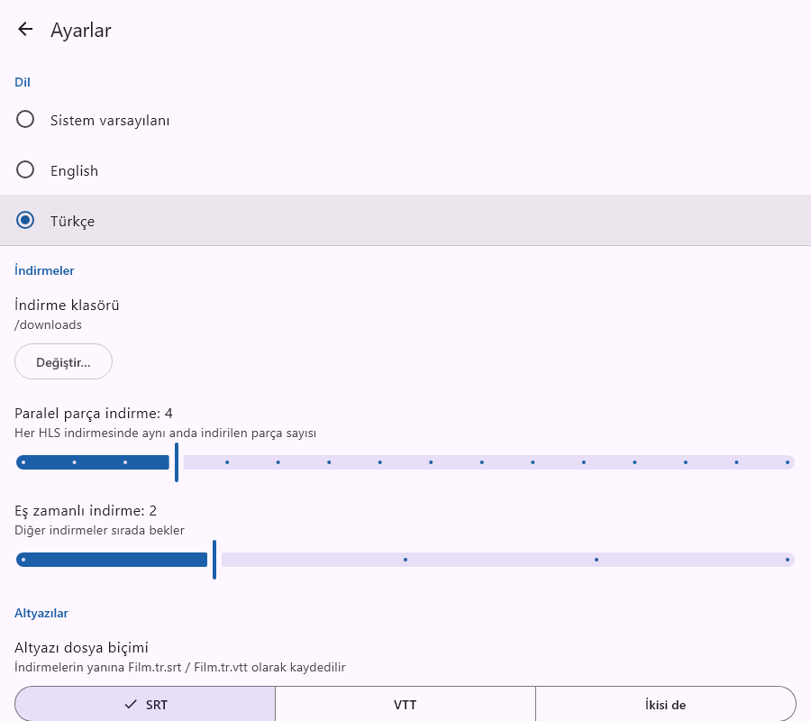
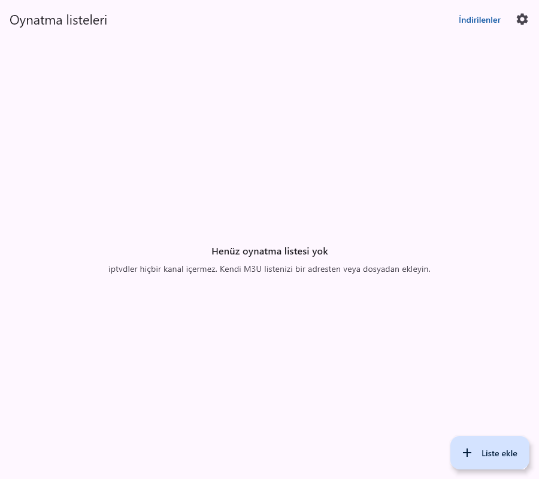

# F1 — Multi-language (English, Türkçe)

The whole UI is translatable. It ships in English and Turkish.

| Settings | Playlists |
|---|---|
|  |  |

## What was built
- **Language setting:** Settings → *Language / Dil* offers *System default*, *English* and *Türkçe*.
  - *System default*, the default, follows the device language: Turkish on a Turkish Windows or Android, English otherwise.
  - The choice applies immediately, with no restart.
- **Coverage:**
  - Every screen and dialog.
  - Download, recording and error messages, including the DRM refusal: "Bu yayın DRM korumalı ve indirilemez."
  - The Android download notification and the "Export…" toast.
  - The desktop quit and crash dialogs, file choosers and VLC hints.
- **Number formatting follows the language:**

  | English | Turkish  |
  |---------|----------|
  | 1.5 KB  | 1,5 KB   |
  | 12,345  | 12.345   |
  | 45%     | %45      |
  | 3 min   | 3 dk     |
  | 5 s     | 5 sn     |
  | 2 h     | 2 sa     |

## How it works
Code is under `shared/src/commonMain/kotlin/io/github/aalpersen/iptvdler/i18n/`.
- **`Strings.kt`:**
  - The `Strings` interface holds one property or function per text.
  - `AppLanguage` is the setting value.
  - `I18n` holds the current `strings`.
- **`EnStrings.kt` and `TrStrings.kt`** are the translations. The compiler rejects a language that misses any text.
- **Using a text:** `import io.github.aalpersen.iptvdler.i18n.strings`, then `Text(strings.downloads)`.
  - Texts with values are functions, e.g. `strings.deletePlaylistMessage(name)`.
  - `I18n.strings` is Compose snapshot state, so composables recompose when the language changes.
  - Non-UI code (the download engine, notifications) reads the same value.
- **Startup:** `bindLanguage()` in `di/Modules.kt` applies the saved setting at startup and on every change.

Why not Compose resources (`strings.xml`)? This way:
- no extra dependency;
- a compile-time check that every language is complete;
- instant switching without platform locale hacks;
- texts are usable from non-composable code.

### Adding a language
1. Copy `TrStrings.kt` to e.g. `DeStrings.kt` (`object DeStrings : Strings`) and translate it.
2. Add `GERMAN("de")` to `AppLanguage` and `"de" -> DeStrings` to `I18n.forTag`.
3. Add its name, written in that language ("Deutsch"), to `displayName()` in `SettingsScreen.kt`.

## Testing
- `./gradlew allTests`:
  - `I18nTest` covers system-language fallback, Turkish number formatting, translated error and DRM messages, and that no text is blank.
  - `AppFlowTest.switchingLanguageTranslatesTheUi` switches to Türkçe in Settings and checks that the screens update. Its screenshots go to `shared/build/screenshots/20-*.png` and `21-*.png`.
- **Manual:** `./gradlew :desktopApp:run`, then Settings → Türkçe. Browse playlists, open the download and record dialogs and the Downloads screen, then switch back to English.

## Known gaps
- **Saved messages keep their language:** messages stored with a download or playlist (e.g. a failed download's error) stay in the language that was active when they were written.
- **Some messages stay English:** low-level technical errors, such as malformed playlist details or verification failures.
- **Early desktop message:** the "iptvdler is already running" box follows the system language, because it appears before settings load.
- **Player-generated text:** track names come from the stream or the player (e.g. VLC's "Track 1"), and quality labels from the playlist (1080p · H.264).
- **Android per-app language:** Android 13's system per-app language setting isn't wired up. Use the in-app setting.
