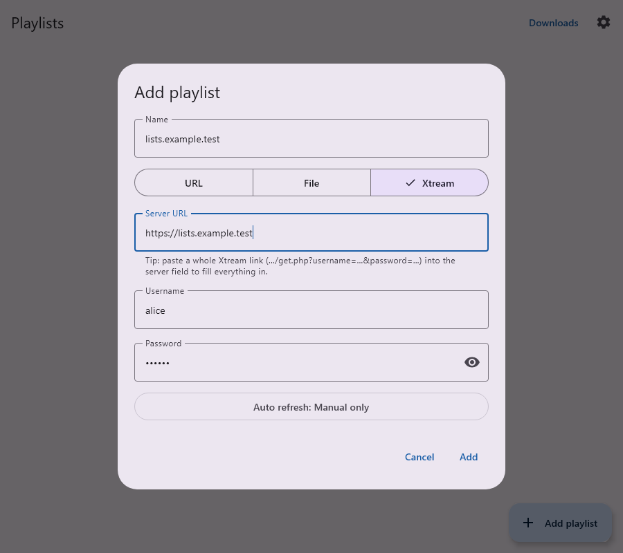
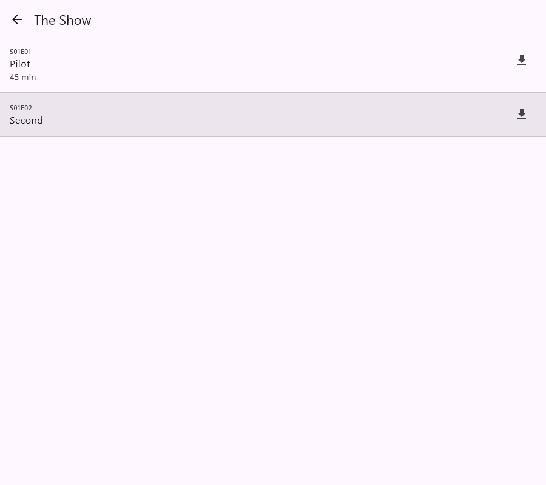
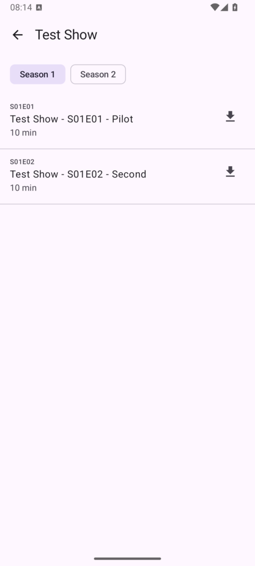

# F2 — Xtream Codes accounts

Add an IPTV account from an Xtream Codes panel, entered as server + username + password or pasted as a link. iptvdler then loads its live channels, movies and series by category. Series open into seasons and episodes, which can be played and downloaded.

| Add dialog (link pasted) | Series episodes (desktop) | Android |
|---|---|---|
|  |  |  |

## What was built
- **Playlist type "Xtream"** in the Add/Edit playlist dialog, next to URL and File. It has server URL, username and password fields; the password is masked, with a show/hide toggle.
- **Links are recognized:**
  - **Pasted into the server field:** any Xtream link fills in all three fields and a playlist name. This works for:
    - `…/get.php?username=U&password=P&type=m3u_plus`
    - `…/player_api.php?username=U&password=P`
    - a stream URL `…/live|movie|series/U/P/123.ext`
  - **Typed into the M3U URL field:** a `get.php` link shows "This is an Xtream link" with a button that switches to the Xtream login. That login gives the full movie and series structure; the plain M3U export often lacks it.
  - **Server addresses are normalized:** `example.com:8080`, a trailing `/` or a pasted `/player_api.php` are all accepted.
- **Loading** goes through `player_api.php`: account → live, VOD and series categories → streams.
  - Every entry gets its category as its group and its proper type (Live / Movie / Series). The existing type filter, search and favorites work on it.
  - Live streams use MPEG-TS when the account allows it, else HLS. Movies keep their container (`.mkv`, `.mp4`…).
  - The account's XMLTV URL is stored as the playlist's EPG URL, for the later EPG feature.
  - Loading reuses the M3U path (staging table, then a swap), so a failed refresh keeps the previous list.
  - A broken movie or series endpoint doesn't hide the live channels.
- **Account status** shows on the playlist: "Account active until 2027-09-26" (Turkish: "Hesap 26.09.2027 tarihine kadar etkin"). An expired, banned or disabled account shows in red.
  - A wrong password gives "Wrong username or password, or the account isn't active."
  - A non-Xtream server gives "This server doesn't answer like an Xtream Codes server."
- **Series:**
  - Tapping a series opens its episode list, with season chips when there's more than one season.
  - Episodes play in the player and download like any VOD. The file name is e.g. "Show S01E03 Title", or the panel's own episode title when it already contains S01E03.
  - Episodes are fetched when the list opens, not stored.
- **Downloads and recording** need no special handling: Xtream movies and episodes are ordinary VOD URLs, and live channels ordinary live streams. DRM detection and refusal apply unchanged.
- **Credentials:**
  - They're stored only in the local database, like the M3U URLs that already contain them.
  - `XtreamCredentials.toString()` masks the password.
  - Series favorites are keyed without the password (`xtream-series:<id>`).

## Code
- `shared/src/commonMain/kotlin/.../data/xtream/`:
  - `XtreamLink.kt`: credentials, link parsing, URL building.
  - `XtreamClient.kt`: a lenient JSON client. Panels mix numbers and strings and use `{}`, `[]` or empty bodies.
- `data/playlist/PlaylistRefresher.kt`: `loadXtream()`.
- `ui/playlists/PlaylistDialog.kt`: Xtream fields and link detection.
- `ui/channels/SeriesScreen.kt`: episodes.
- `PlayerRoute(url, title)`: plays streams that aren't channel rows.
- DB v6 (`migrations/5.sqm`): `playlist.xtream_username / xtream_password / account_status / account_expires_at`, `channel.series_id`.

## Testing
Automated (`./gradlew allTests`):
- **`XtreamLinkTest`:** link formats, encoded passwords, scheme-less input, server normalization, URL building, the password masked in `toString`.
- **`XtreamRefreshTest`** (mock API):
  - types, groups, URLs, logos, EPG ids and account info;
  - a wrong password keeps the old list;
  - an expired account, a broken series endpoint, a non-Xtream server;
  - series info in both JSON shapes.
- **`MigrationTest`:** a v5 database upgrades to v6 and keeps its data.
- **`AppFlowTest.addXtreamAccountByPastingALinkThenPlayAnEpisode`:** paste a link, add the playlist, see the account line, open series → episodes, play an episode. Screenshots are saved as `shared/build/screenshots/30-32*.png`.

Manually, with the fake panel in `docs/tools/fake_xtream_server.py`. It serves the API and redirects its streams to the public Mux, Apple and Unified Streaming test streams; it has no real channels.
```sh
python docs/tools/fake_xtream_server.py        # http://127.0.0.1:8001, login demo / demo
adb reverse tcp:8001 tcp:8001                  # Android emulator only
```
In iptvdler: Add playlist → Xtream → paste `http://127.0.0.1:8001/get.php?username=demo&password=demo&type=m3u_plus`.
- Live, movies and a two-season "Test Show" appear.
- A movie and an episode play.
- An episode download completes. This was checked on the Android emulator: the 184p Mux episode, 21.4 MB.
- Alternatively, type the same link into the URL field and tap "Use as Xtream login".

## Known gaps
- **Catch-up / timeshift (`tv_archive`) and EPG** are for a later feature. The XMLTV URL is already saved.
- **Not stored:** episode lists and movie details (plot, rating, cover) are fetched on demand or not shown yet.
- **Password change:** changing an account's password changes its live and movie URLs, so favorites and recents of those entries are lost. Series favorites are kept.
- **Server URL from the panel is ignored:** some panels report a different streaming host in `server_info`. iptvdler uses the server the user entered, which is what most apps do.
- **Parental-control categories** aren't filtered or hidden.
