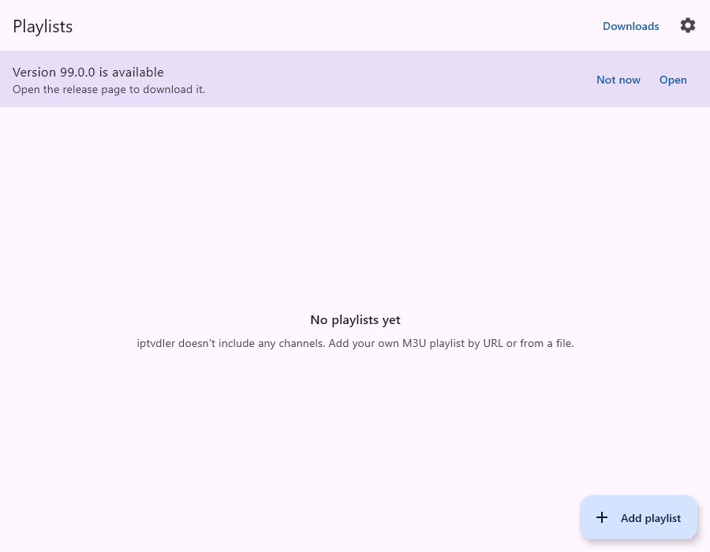

# 03 — Update check

Outside an app store there are no automatic updates. iptvdler can tell the user when a newer release is on
GitHub. It **only links** to the release page: nothing is downloaded or installed by the app.

## What was built
- `core/update/AppVersion`: parses `1.2.0`, `v1.2.0`, `1.2.0-beta1` and compares numerically (`0.10.0` > `0.9.0`).
  A pre-release is older than the same version without a suffix. Anything unparseable is never "newer".
- `data/update/UpdateChecker`:
  - `GET https://api.github.com/repos/aalpersen/iptvdler/releases/latest` (unauthenticated; that endpoint skips drafts
    and pre-releases), at most once per 24 h, triggered at app start and when the setting is switched on.
  - Failed checks (network errors, 5xx, invalid JSON) are logged and retried at the next start. A 404 (no release
    yet) counts as a completed check.
  - The newest version and its page are stored in settings, so the banner survives restarts without a new request.
  - The page URL is only used if it starts with `https://github.com/aalpersen/iptvdler/releases/`; otherwise the
    generic releases page opens.
- `AppSettings`: `updateCheckEnabled` (default **on**), last check time, latest release, dismissed version.
- UI:
  - Playlists screen: banner "Version X is available" with **Open** (system browser via `LocalUriHandler`) and
    **Not now** (hides that version; a later release shows the banner again).
  - Settings → About → **Check for updates** switch. Turning it off hides the banner and stops all requests.
- English and Turkish strings.

Privacy: the request reveals the user's IP address and the `iptvdler/0.1` User-Agent to GitHub, once a day at most.
No identifiers or settings are sent. The setting's description says what it does.

## How to test
- Unit: `./gradlew :shared:desktopTest --tests "*AppVersionTest*" --tests "*UpdateCheckerTest*"`
  (version ordering; newer/same/older release; once-per-interval; off switch; dismiss; pre-release and
  foreign-URL handling; error handling).
- UI: `./gradlew :shared:desktopTest --tests "*AppFlowTest.updateBanner*"` shows the banner, checks that
  **Open** passes the release URL to the URI handler and that **Not now** hides it. Screenshot:
  `shared/build/screenshots/40-update-banner.png`.
- Manual (once a release exists): set `iptvdler.versionName` in `gradle.properties` below the latest release,
  run `./gradlew :desktopApp:run`, and the banner appears after a few seconds. To check again right away, clear
  the stored state:
  - Desktop: delete the `update_*` values under `HKCU\Software\JavaSoft\Prefs\io\github\aalpersen\iptvdler`
    (Windows), or the app's preferences on macOS/Linux.
  - Android: clear the app's storage, or reinstall.

## Known gaps
- Unauthenticated GitHub API calls are rate-limited to 60 per hour per IP. With one check per day per device
  that's only a problem behind large shared NATs; a failed check simply retries at the next start.
- No "check now" button; the check runs at most daily.
- If the repository moves, older installs keep asking the old URL (GitHub redirects renamed repos).
